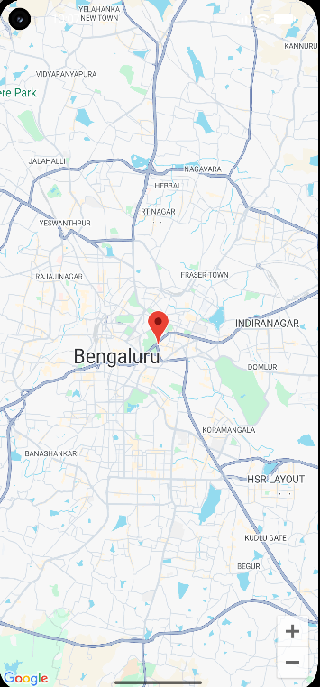

# Google Maps Android Application

 

## Experiment 11

**Aim:** To develop an Android application that displays Google Maps.

 

## Description

This Android application displays Google Maps using the Google Maps SDK for Android. It opens the map centered on Bengaluru and displays a marker labelled **Bengaluru**. Zoom controls are enabled.

 

## Technologies Used

- Android Studio

- Kotlin

- XML

- Google Maps SDK for Android

- Gradle

 

## Features

- Displays Google Maps inside the Android application.

- Shows a marker at Bengaluru.

- Centers the map on Bengaluru when the app opens.

- Provides zoom-in and zoom-out controls.

 

## Application Output

 

 

[View the output screenshot](https://github.com/Lathika-kathirvel/GoogleMapApp/blob/main/Screenshort/Output.png)

 

## How to Run

1. Clone or download this repository.

2. Open the project in Android Studio.

3. Add your own Google Maps API key using the Android manifest configuration.

4. In Google Cloud Console, enable **Maps SDK for Android** and configure billing as required.

5. Sync the project with Gradle.

6. Run the app on an emulator with Google Play services or on a compatible Android device.

 

## Result

Successfully developed an Android application to display Google Maps using Kotlin and the Google Maps SDK for Android.

 

## Repository

[GoogleMapApp on GitHub](https://github.com/Lathika-kathirvel/GoogleMapApp)

 

---

**Security note:** Do not commit an unrestricted Google Maps API key to GitHub. Restrict the key to your Android package name and signing certificate, and keep private credentials out of the repository.

 
